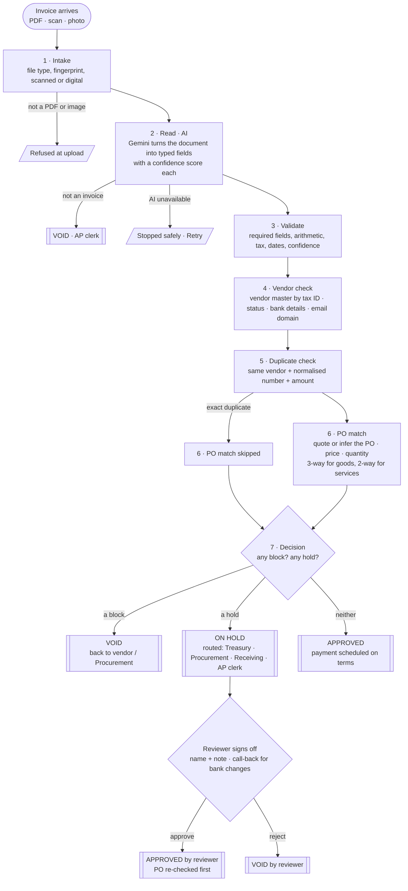

# Process map

Mapped in [`SPEC.md`](SPEC.md) before the build; this is the readable version, kept in step with the code. **Input:** one vendor invoice (PDF, scan or phone photo). **Output:** a decision an AP manager can act on: approve and schedule payment, hold and route to a named team, or reject, with the reason in plain English.

Stages 1 and 2 handle the document. From stage 3 onward everything is deterministic code ([`src/rules.js`](../src/rules.js), [`src/decide.js`](../src/decide.js)). The AI never makes a decision.

## Each stage on one line

| # | Stage | Input | What it checks | Decision points (reason code → effect) | Output |
|---|---|---|---|---|---|
| 1 | Intake | the file | type, size, SHA-256, page count, text layer | seen this exact file before → `DUPLICATE_FILE` hold | file facts |
| 2 | Read (AI) | the file | Gemini structured extraction, temperature 0, schema-locked | not an invoice → `NOT_AN_INVOICE` **block**; misread day/month settled against the printed terms | typed fields + confidence |
| 3 | Validate | fields | required fields; qty × price, lines → subtotal → tax → total; dates; tax-ID format; confidence < 0.7 | `MISSING_FIELD`, `ARITHMETIC_MISMATCH`, `DATE_OUT_OF_RANGE`, `LOW_CONFIDENCE` → hold | checked fields |
| 4 | Vendor | fields + vendor master | match by tax ID, else name/aliases; status; bank account and routing; email domain | `VENDOR_BLOCKED` **block**; `BANK_DETAILS_CHANGED`, `REMIT_DOMAIN_LOOKALIKE`, `VENDOR_UNKNOWN` → hold | matched vendor |
| 5 | Duplicate | fields + ledger | normalised number (case, punctuation, leading zeros) + amount, same vendor | same number + amount → `DUPLICATE_INVOICE` **block**; near match → `POSSIBLE_DUPLICATE` hold | link to the original |
| 6 | PO match | fields + POs + receipts + ledger | quoted or inferred PO; vendor, currency, open; unit price ±2%; header ±2% and ≤ $100; qty ≤ received − already invoiced | `PO_CLOSED`, `PO_NOT_FOUND`, `PRICE_VARIANCE`, `PO_OVERRUN`, `QTY_EXCEEDS_RECEIPT` → hold; `PO_INFERRED` info | line-by-line match |
| 7 | Decision | all reasons | any block → reject; else any hold → review; else approve | route by priority: Treasury > Procurement > Receiving > AP clerk | stamp, explanation, next actions, payment date, vendor email draft |

## Which stage catches each demo case

| Input | What's wrong | Caught at | Result |
|---|---|---|---|
| 01 Acme | nothing: the happy path | all pass, 3-way match | APPROVED, paid on Net 30 |
| A Peak Valley (upload) | nothing: services | 6, 2-way match | APPROVED |
| 03 Peak Valley scan | no PO number on a scan | 6 infers the PO (one clear winner) | APPROVED, PO inferred |
| 05 Northstar 2 of 2 | bills goods not yet received | 6, 3-way quantity | ON HOLD → Receiving |
| 06 Acme resend | same invoice, new layout, extra zero | 5, normalised number + amount | VOID, linked to the original |
| B Globex (upload) | vendor blocked in the master | 4 | VOID → Procurement |
| C Acme (upload) | bills against a closed PO | 6 | ON HOLD → Procurement |
| 07 Kestrel | bank details changed, lookalike domain | 4 | ON HOLD → Treasury; approval needs a call-back |
| 08 Lumen | no invoice number or date | 3 | ON HOLD → AP clerk, vendor email drafted |
| 10 Brightline photo | text telling the AI to skip checks, and 4.4% over the PO price | 2 reports it, 4 and 6 hold it | ON HOLD → Treasury |
| any non-invoice PDF | not an invoice | 2 | VOID → AP clerk |

## Why each tool is here

| Tool | Job | Why this one |
|---|---|---|
| Gemini Flash-Lite (REST, JSON schema) | reading the document | The job is reading, not reasoning: cheap, fast, and it handles scans and photos. It runs at temperature 0, falls back to a second model, and caches by file hash. |
| Plain JavaScript rules | every decision | Auditable and repeatable: the same invoice and data always give the same answer, and each answer traces back to a rule and a number. |
| CSV → SQLite (`node:sqlite`) | vendor master, POs, receipts, ledger | The master data is a "spreadsheet" a controller can edit. It is reloaded on every boot, and the ledger lives in the database. |
| Server-sent events | live run view | Each stage is pushed to the browser the moment it finishes. |
| Vanilla JS front end | Process, Runs, Procurement data | No build step, nothing to break on demo day. |
| `node:test` + `scripts/eval.js` | 136 tests + end-to-end eval | The eval runs all ten samples against the live server: 10/10 decisions and fields on fresh reads. |
| Render (free) | hosting | One click from `render.yaml`. It sleeps when idle, so open it a minute before a demo. |
| AI coding assistants | building it | They helped with code, test invoices and the review passes; every rule and threshold was chosen and checked by hand. |
